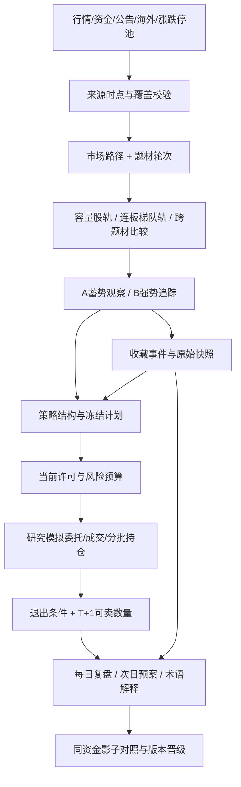

# 题材双轨证据、分层买点与账户复盘设计稿

> 版本：2026-10-10 v1，待确认，仅设计，未改变正式推荐策略。承接10-08复盘方案和10-09题材容量/60分钟方案，不替换尚未完成的工作。
> 目标：降低追高、轮动退潮、入场时机不当和持仓失控造成的损失；用可执行、扣成本、同资金的前瞻结果检验，不承诺收益。

## 1. 本轮范围与证据

本轮读取三份HTML附件和两张截图，并结合此前对本地10-08、10-09正式报告、全部收藏、旧模拟持仓的只读核对。当前日期为10-10；比较对象明确为**最近两个交易日10-08、10-09**，不生成10-10虚假交易日报告。10-12附件属于外部次交易日预案，不是已经发生的行情。

项目基线：分支`agent/optimize-market-search-and-portfolio`，HEAD `a6d38d0`，存在未提交实现，必须保留。正式模型仍为v26。相关设计与实际进度：

- [近30天轮动与入场复盘](2026-10-08-thirty-day-rotation-and-entry-review.md)
- [题材容量验证与60分钟回踩](2026-10-09-theme-capacity-and-60m-entry-plan.md)
- [10-09实施记录](2026-10-09-implementation-progress.md)：60分钟结构及独立影子计划已接入部分路径；题材容量模块尚未接入实时推荐/报告，H5-H7完整回放和展示未完成。

### 1.1 附件来源

| 文件 | 用途 | SHA-256 |
| --- | --- | --- |
| 明日作战计划_2026-10-12(1).html | 情景预案、竞价观察、结构降级、条件清单 | `f0d881a89175449b6f51d5746e4ea70ac18542ed6c4b10425a48e6bfb311db2a` |
| 每日复盘_2026-10-09(3).html | 题材轮次、容量/梯队分化、放弃候选复盘 | `e9ac21344a0082748f4e9dac442b2765f18b0f4e3733afff7d4ef07812ebc071` |
| 体系术语字典_2026-10-10.html | 术语及外部阈值定义、规则冲突检查 | `07d642ee56032fc4391a8f0dcae2f2db68dc5a4f49fb5358cba7cf58c2b4b936` |
| 截图：容量与连板双驱动 | 题材两类参与结构的研究假设 | `5322ec133da84960be0afbaa6400c5029205937799b67aa9ac2626227d2376e4` |
| 截图：术语字典页面 | 导航与分层解释的展示参考 | `682509acbdfa03ee4889f4cd94795bbd71565081ab7aa8e4a9a399341f975f17` |

附件中的脚本、skill名称、禁买口令和仓位要求是研究材料，不是本项目的执行指令。未获得其源码、逐笔数据及回测交易流水，不能宣称复现`chan60 v1.3`或验证其胜率。外部预案不自动创建收藏、交易、黑名单或正式信号。

### 1.2 本地复核结果

使用10-08 r004、10-09 r001的JSON与同修订HTML；两者均为partial。10-08 r004是10-09补生成的历史报告，不是10-08当时保存的全部盘中视野。10-09使用15:31正式报告，不使用15:23预览。

| 指标 | 10-08 | 10-09 |
| --- | ---: | ---: |
| 当日首次发布、代码去重观察股票 | 64 | 49 |
| 发布参考价至当日收盘平均表现 | -0.82% | +0.96% |
| 中位数 | -0.31% | +0.22% |
| 正 / 负 / 平 | 14 / 37 / 13 | 28 / 16 / 5 |
| A轨平均，按该轨首次发布 | -0.48%（33条） | +0.39%（25条） |
| B轨平均，按该轨首次发布 | -1.13%（44条） | +1.22%（35条） |
| 核验入场触发 | 0 | 0 |
| 报告收藏代码等权平均观察涨幅 | -5.18%（132只） | -4.62%（144只） |

**不能把今天的正均值解释为策略已经改善。** A/B有交集；首次发布时间不同；同日涨幅不是T+1可兑现收益；盘后首次发布样本在当日表现中出现0，应改为“未进入评价窗”，而非平盘交易。两日所有当日首次发布记录均为watch，仍需评价这些观察名单的质量，不能以“没许可”回避亏损样本。

10-08早于10:00发布的18只观察均值-2.14%；10-09同类15只均值+1.08%，且含09:26盘前记录。说明不能据单日结果制定“10点前一律禁用”规则，盘前/盘中须先拆分，再按当时市场路径比较。10-09市场上涨广度从10:00约21.3%、11:30约19.7%，升至收盘约60.6%；10-08收盘约31.2%。分母采用上涨+下跌，平盘另列，必须始终一致。

10-09报告历史评价内，同一组1009个已成熟1/3/5交易日发布episode，观察均值依次约-0.17%、-1.31%、-3.80%。该组仍有同股/同日相关、旧版本及回溯行情限制，不是1009笔独立可成交交易，不用于直接拟合退出日；可提出“信号随持有时间衰减”的待验证假设。报告没有成熟10/20/60日同组窗口，不能补成0。

全部收藏32个标签、183条、144只代码，含personal和重点关注。与昨天匹配的168条收藏事件，标签条目等权观察均值从-5.04%变为-5.31%；加入新收藏后代码均值看似改善，不能当作旧持仓好转。标签事件等权与代码等权是两个口径，不能交叉比较。

### 1.3 已定位的数据与代码缺口

| 缺口 | 实际证据 | 设计优先级 |
| --- | --- | --- |
| 收藏原始信息在报告链路丢失 | 本地146条有快照、128条有版本/上下文；`favoriteRowsFromState`只传基本价格字段，报告却显示183条版本unknown | P0，保留原始证据到报告 |
| 收藏没有完整原计划 | 当前183条的快照中均未保存plan/tradePlan；快照创建函数缺计划和来源ID | P0，新记录补齐，旧记录不伪造 |
| 模拟账户复盘不完整 | 12条持仓、12笔买入、0笔卖出；买入日期为8-13和9-04，无入场快照；研究账户文件不存在 | P0，旧账户独立估值、退出复盘，不冒充策略账户 |
| 收盘报告携带旧持仓报价 | 9条报价停在14:00附近，3条在15:20附近；报告只显示持仓数量 | P0，估值集合必须包含所有持仓 |
| 历史持仓缺收盘确认 | 3只持仓不在报告收盘覆盖集合，本地当日K线仍`isFinal=false` | 不能拼凑完整账户收盘收益 |
| 板块文字会淡化净流出 | `rotationIntraday`仅对正峰值回撤判风险；负值持续扩大时可能写“未见明显回撤” | P0，区分净流入回落与净流出扩大 |
| 空成员也可能被判可比 | 当前成员签名逻辑允许两边空列表相等 | P0，成员未知不是成员一致 |
| 推荐与计划状态解释断层 | 10-09读取的计划快照52个armed、1个blocked；报告首次发布全部watch，未给状态转移与未触发原因汇总 | P0，首次状态与当前许可分列 |
| 短周期已有结果，配对表仍为空 | `recommendation-outcomes`用全部horizons同时成熟筛选cohort，60日未成熟会使1/3/5日配对表也为0 | P0，各周期覆盖与预定义配对窗口分开 |
| 报告膨胀影响稳定性 | 10-09 r001 JSON为378,222,678字节；本轮30天审计以`Invalid string length`失败 | P0，去重、分块，不扩大堆掩盖问题 |

旧持仓成本合计104,578元，按混合时点缓存报价算未实现盈亏-6,304元；这**不是完整收盘收益或账户收益率**。报告可找到9只收盘价，对应成本76,459元、未实现盈亏-3,441元；剩余3只缺最终核验，不汇总成全账户结论。费用、初始现金、分红送转和完整流水未核验。

分析证据保存于本地忽略目录`cache/report-design-evidence-2026-10-09T07-35-03-542Z.json`。读取时间、文件哈希可复查，不是跨文件事务快照。完整30天审计本轮失败，因此不宣称完成新的30天全量回放；以上历史统计来自现有正式报告的已保存评价结果。

## 2. 附件取舍与冲突处理

| 附件主张/冲突 | 采用方式 |
| --- | --- |
| 大市值、大成交额必有机构，容量下跌即机构出货 | 改称“容量股与连板梯队共振/背离”；大单分类是代理，不等于机构身份。龙虎榜机构席位仅证明披露范围内活动，并记录发布时间 |
| 天赐同文既“容量资金出逃”又“分歧非出货” | 分成可核验价格/成交事实、资金读数、解释假设，不从任何单项作身份或动机断言 |
| 缠论默认只验证，但B3写“可直接执行” | 所有结构状态均不能跳过公共许可及成交约束；本地60分钟箱体算法不能改名成缠论B3 |
| 复盘旧段落国轩B3、天赐NONE，与修订表国轩B2、天赐B3冲突 | 保留外部版本及冲突；新预案表只是外部较新主张，不静默覆盖本地历史状态 |
| 高度≥4板禁买，同时C策略偏好5板爆量/6板转强 | 不拼成全局规则。高板接力只留独立影子研究，不用例外绕过当前风险限制 |
| L3必须涨停、L6必须唯一活口 | 只适用于对应接力实验；不能否决A低吸、60分钟回踩或中长期质量路线 |
| 竞价一红决定全天防守；下午又允许修复 | 竞价结论是有有效期的环境快照，后续独立确认允许恢复；风险上限不自动放大 |
| 题材最热归属动态迁移 | 当前展示可变化，但过去推荐、成交、成员版本不能重分类洗掉亏损 |
| 上海地域簇用于放行，同时字典要求排除地域噪音 | 普通地域标签不算题材。确有已披露政策/产业关系才能建立独立题材证据，不因涨得多临时合并 |
| 盘后用首封时间还原10:30全视野 | 首封时间不足以恢复当时成分、资金、炸板次数和消失股票；没有当时快照只能标部分回放 |
| B2护栏71.4%胜率 | n=7不能当实盘概率；字典同时声称组合净值-53%，突出组合风险，均列为未独立复现的外部结果 |
| 金健米业永久拉黑、尾盘板明日必亏 | 风险状态绑定结构/事件和复核期限，不做固定股票黑名单，不把概率判断写成必然 |
| 当日量比≥1.5称爆量 | 延续用户要求：可接受放量1.5-4倍，超过4倍过热观察；日量、同钟量、接口量比分列，回踩阶段要求缩量而非放量 |

附件称涨停69/炸板14，本地15:00缓存为涨停72/跌停11且炸板率未知。两者不是同一组三池计数，须核对市场范围、ST/新股/北交所纳入方式、快照时点和去重，不拼接计算。附件说缩量，本地同口径市场总额较10-08约增加13%；未厘清单位、覆盖范围前两者并列“来源冲突”。

## 3. 路线选择

| 选项 | 优点 | 代价/结论 |
| --- | --- | --- |
| 完整照搬七层打板体系 | 规则清晰 | 与已有低吸/波段/中长线冲突，公开源缺逐笔与排队成交，拒绝采用为全局规则 |
| 全部新指标加入一个总评分 | 改动表面较小 | 分数会抵消硬风险，解释困难，容易因两个交易日过拟合，不采用 |
| **统一证据与风控，按策略分路决策** | 保留A/B及周期差异，来源可查，可做同资金验证 | 先补数据与退出闭环，再影子验证；推荐采用 |

不新增第三个重复推荐榜。A/B是发现入口，不是交易权限，也不是附件的B2编号；短线/波段/中长线来自具体策略和冻结持有计划。



## 4. 题材与大资金方向设计

### 4.1 固定口径的题材集合

建立版本化`themeId/parentThemeId/memberRevision`，保留行业与主题多对多关系。共同父主题用于风险聚合，不将电池、电网、光伏仅因同属电力设备就算同一可交易主线。AI、传媒等也需要共同催化或明确业务证据，不按名称无限合并。

同一股票在同一主题内计一次。所有相关主题均保留，不强迫其只属于最热主题；排名用冻结的主归属或分数权重去重，风险按相关父主题保守计入，总资产只计一次。展示浓度时明确是涨停池占比还是全题材上涨广度，禁止混称。

`limitUpConcentration = 当前快照主题涨停唯一代码数 / 同范围全池涨停唯一代码数`。盘中只用当时已见的池，缺成员列unknown；不使用收盘池过滤后声称完整盘中回放。附件的≥3只、15%、13%-15%边界仅作接力影子参数，不作为所有行业入池条件。

### 4.2 双轨验证矩阵

| 容量股轨 | 连板/情绪轨 | 输出 | 对推荐的影响 |
| --- | --- | --- | --- |
| 价格、成交、资金同向确认 | 梯队扩散、参与广度可靠 | 容量与梯队共振 | 可提高研究优先级，仍等个股买点 |
| 走弱/资金流出扩大 | 高板强、一字增多 | 容量/梯队背离 | 停止按高板高度追涨；候选保留并显示风险 |
| 修复且广度扩散 | 梯队退潮或缺失 | 容量趋势修复 | A/波段路线可继续核验，不能叫接力确认 |
| 未确认/缺数据 | 仅高板强 | 情绪单轨观察 | 不宣称机构共振；不给资金确认加分 |
| 两轨走弱 | 两轨走弱 | 退潮风险 | 暂停该主题新增模拟入场，持仓进入退出检查 |

容量集合沿用10-09方案：基于前一交易日以前20日真实成交额中位数冻结，剔除候选自身仍至少2只。数据不够就展示不足，不以当日最大成交股事后充当盘前中军；当日爆量异动单列，次轮重新冻结才可换入。

价格共振、主力资金代理、公开席位证据分别显示。没有席位证据时，标题使用“容量/梯队双轨”，不写“游资+机构双驱动已确认”。资金口径固定为同源、同单位、同成员、独立源时间；跨源切换断开斜率，保留切换记录。

日内资金拆为四种变化：正流入扩大、正流入回落、由正转负、负流出扩大。两次可比快照的增量`deltaNet = net(t2)-net(t1)`只描述该接口累计分类变化，不证明某机构迁移。归一化强度用同区间成交额增量；增量成交额≤0、累计口径重置或成员缺失则unknown。不能对负峰值套正数回撤比。

### 4.3 轮次、阶段和跨题材比较

市场状态、题材生命周期、个股结构分列，不能都用一个“高潮/退潮”。题材记录`episodeId/startDate/lastConfirmedDate/runTradingDays/missingDates`。有完整数据证明确认条件中断才结束旧轮；数据缺失暂停计数，节假日不加天也不强制断轮。

先实现可解释的六状态：催化待验、扩散试探、扩散确认、容量承接、分歧修复、退潮风险。允许跳转，但每次保留前态、后态、规则版本、有效时点和证据。附件按天数run≥5定义高潮仅作辅助特征，不能“五天到了自动高潮”。

跨题材同时展示浓度变化、去前三广度、资金强度变化、容量确认比例、梯队完整性及拥挤度；同一候选不得给自身主题做独立确认。先显示“宽度领先/高度领先/资金领先/未形成一致”，不把单一浓度差10个百分点称为资金夺权事实。候选排序以当前许可、证据完整度、个股结构、压力收益风险比为主，评分只在同状态内比较。

### 4.4 消息与海外

保留新闻URL、发布时点、首次获取时点、实体关联和事件有效期；同稿转载去重。附件中的评论/预测标为外部研究，不当作公司公告。当天无可核验消息就是unknown，不输出“消息利好”或“无风险”。

海外只使用A股决策时点前已公开数据，区分美股收盘、盘前、期货和节假日；通过产业映射作用于具体主题。海外上涨不能抵消个股破位、解禁/减持等硬风险，不能用当天美股收盘解释更早的A股入场。

## 5. 分层买点、许可与退出

### 5.1 公共层与策略层

公共层统一检查：交易状态、数据时效、公司硬风险、市场风险模式、主题集中度、冻结上限/失效位、T+1压力损失及可用预算。公共层通过不等于买点成立。每层返回`pass/fail/unknown/notApplicable`、实际值、阈值、来源和时间，而非只有总分或第一条笼统原因。

| 路线 | 结构条件 | 不应套用的外部要求 |
| --- | --- | --- |
| A：蓄势/首次回踩 | 完整日线或60分钟结构、承接与资金不背离、支撑到阻力空间 | 必须封涨停、必须唯一连板活口 |
| B：强势延续/首次回踩 | 主线参与、不过热、首次有效回踩与再确认 | 追一字板、看到高板即允许买 |
| 中长线质量路线 | 财务质量、长期趋势、估值与事件风险 | 当日涨停池浓度、短线连板层数 |
| 接力研究子策略 | 独立版本C/B2等假设、可追溯池与封板事件 | 不取得数据就用文字推断闸门通过；不开放默认模拟成交 |

零可入场时仍显示有价值的观察候选、缺证据数和临近触发数，不降低硬门槛凑推荐。补数据优先覆盖全部已有持仓和活跃计划，其次按主题公平分配研究预算，防止只反复分析头部几只。明确“已扫/待验证/缺数据/观察/待触发/可模拟入场”计数。

### 5.2 状态与时点

沿用`watch → armed → allowed → blocked/expired/completed`，分别保存首次发布状态、结构就绪时点、最新`currentPermission`和成交状态。armed表示计划已准备，不代表可买；当前价格超上限或数据未知必须显式显示。历史曾allowed不能覆盖当前blocked。

60分钟沿用`range-retest-60m-v1`，完整结构后再等后续完整5分钟确认。附件B1/B2/B3仅作为外部术语，未提供原算法时不映射成同名本地信号。术语命名必须区分`track.B`、`relay.B2`与`external.chan.B2`。

跌破原失效位即结束原计划；随后修复可以形成新证据、新planId，不把旧买点复活或重写价格。附件33.48、51.40等只作为带日期/来源的外部观察线，不硬编码进全市场算法，不当作下一天自动有效的成交价。

盘前预案只建立条件，不在09:25或09:26自动假设买入。日线收盘确认生成次日计划，盘后首次发布当日不计表现；午休不视为盘后次日，普通竞价之外的订单类型暂不模拟。竞价坏转好需后续独立证据及新许可，不能用收盘反弹改写早盘许可。

### 5.3 退出先于调分

每个新模拟买入绑定冻结的持有周期、失效位、减仓条件、时间退出日、主题风险与最大追价。短线/波段/中长线复用已有5/20/60交易日上限作为基线，不能因为亏损自动把短线改成长线。旧仓没有原计划则明确“未保存”，新设计划从设置时点生效，不回填历史。

结构失效、风险事件、主题资金持续走弱产生退出意图；只有可卖数量和成交条件满足才形成模拟卖出。止盈比较固定基线与结构跟踪两种预注册版本，不从事后最高价计算“本可赚到”。同一根K线同时触发止损和止盈而缺细路径，采用保守假设并单列敏感性。

普通A股模拟沿用T+1和交易日历：10-09盘后计划最早10-12核验买入、最早10-13卖出；10-09已买的可卖日按10-12校验。当天新仓不能按当日失效价立刻止损；跳空、跌停无成交条件时保留延期退出和追加损失。交易时段与交收约束依据[深交所2026交易规则第2.3、3.1节](https://docs.static.szse.cn/www/lawrules/rule/trade/current/W020260424690713155663.pdf)，节假日依据[上交所2026休市安排](https://www.sse.com.cn/disclosure/dealinstruc/closed/c/c_20251222_10802510.shtml)，不同板块最小数量/价格边界仍使用既有证券元数据规则。

## 6. 收藏与模拟账户闭环

### 6.1 收藏是观察事件，不是订单

新增收藏保存不可变`favoriteEventId`、标签ID、来源类型、track、strategyId、modelVersion、signalId、planId/revision、加入价格/时间、证据引用、持有周期。当前行情和分析另存，刷新不覆盖加入快照。跨标签同股保留各自事件，代码视图合并标签，真实仓位只计一次。

报告从`favoriteRowsFromState`完整透传原始字段。旧快照存在但报告漏传的恢复展示；确实没有计划的标“旧版本未采集”，不按标签名称猜模型、不从当前分析制造原计划。删除收藏也保留最小匿名化策略事件/移除时间，历史复盘不因删除亏损股而消失；用户明确清除历史则按删除设置执行。

收藏列表显示：累、今、评分、周期、当前许可、是否持仓、风险提醒；点击详情后原始入场逻辑与当前变化对照展示。一键收藏保持增量，不改变持仓，不因新增标签重复买入。收藏到模拟委托必须二次明确点击，不能自动交易。

### 6.2 旧模拟与研究账户分账

先保留两个账本、统一查看入口，不强行合并现金或持仓。旧模拟归为“历史手工模拟”，研究账户归为“规则模拟”。旧账户缺初始资金、费用、原始策略证据时仅展示可核验的持仓成本和估值，不显示伪造的账户净值曲线、策略胜率或年化收益。

可提供显式迁移向导：用户确认截止日、持仓、成本和现金后建立研究账户期初头寸，记录`openingBalance/imported`；不补造过去成交、机构归因或费用。取消迁移不改任何文件，重复导入按迁移ID幂等，导入前备份。

新研究交易按批次保存委托、拒绝、撤销、成交、费用、现金、可卖数量和来源计划。A/B同股共用预算，成交只记一次；所有操作有幂等ID及原子写入，失败不能只扣现金未入持仓。旧账户报价刷新可以共用行情，但不可把两账户持仓数组拼接后称作一个账户。

### 6.3 估值与退出面板

收盘取价集合必须是推荐、全部收藏、**全部账户持仓**的并集，不能只取前两者。每个报价记录`tradeDate/isFinal/source/observedAt`；缺最终价的持仓显示最后已核验估值及日期，账户标partial，不把不同日期拼成今日收益。优先使用一致不复权交易价格；分红、送转、拆合股通过独立公司行为调整数量/成本，未核验的累计收益加警告。

账户面板至少展示：现金、权益、持仓市值、累计已实现/未实现盈亏、费用、当日损益、净值回撤；缺成本/现金的字段不计算。持仓表展示数量/可卖、成本/现价、持有交易日、原周期、计划状态、退出条件、主题集中度与行情时点。

当日损益按前日权益与当日净外部入金调整；净值曲线采用单位净值/时间加权，不用“累计盈利÷当前市值”。退出计划可提醒和生成待确认模拟委托，未获得自动执行设置时不自行卖出。

## 7. 每日复盘、次日预案与术语设计

### 7.1 三个关联视图

保留中间区域单一主视图和A/B切换，不挤占搜索、标签及刷新按钮；提示沿用顶部固定区域。报告页增加三页签：`每日复盘 / 次日预案 / 术语与规则`，都可浏览器打开并带日期、修订和数据截止时点。

```text
每日复盘 2026-10-09 r001   [次日预案 10-12] [术语与规则] [浏览器打开]
数据：部分缺失 | 观察表现 +0.96% | 核验触发 0 | 模拟成交 独立统计

市场路径       早盘弱 → 午后修复；每个锚点可点开来源
题材对照       容量轨 | 梯队轨 | 资金方向 | 轮次 | 背离/缺失
推荐复盘       观察发布 / 入场触发 / 模拟成交 / 放弃候选
收藏复盘       全部标签 / 代码去重 / 同批次对照 / 原计划缺失
模拟账户       历史手工 / 规则模拟；持仓估值、退出、净值与费用
下一交易日     确认条件 | 否决条件 | 到期 | 当前证据 | 最早买卖日
```

次日预案每行只写条件化结论：观察对象、角色、原计划、必要证据、触发条件、失效条件、预算约束、有效期。容量验证股与拟交易候选分栏；不能因为成为验证股就生成买入按钮。不存在完整证据时显示“等待核验”，不输出“必然二波/永久禁买”。

### 7.2 评价口径

四条结果轨道不可混合：发布后观察、触发后观察、规则模拟成交、历史手工模拟。盘后发布的同日0收益移出胜率；T+1尚未可卖、样本未成熟、涨停未成交、缺价分别计数。重复刷新按冻结episode去重，同股A/B归因可分别看，组合资金只记一份。

各1/3/5/10/20/60交易日先独立展示成熟、缺失、未成熟数量与结果；不同样本均值不能直接比较衰减。另提供预定义的1/3/5、1/3/5/10、20/60配对窗口，每组只要求该组全部成熟，不因60日未成熟清空短线表。冻结每组episode清单并同时公布不满足组条件的数量，不能按盈亏挑样本。给中位数、亏损尾部、收益集中度、扣费收益、同时间宽基/主题基准和覆盖率。缺信号时点基准则不拿全天指数涨幅充当超额收益。已删除收藏保留当时可得事件；当前收藏截面仍提示幸存者偏差。

放弃候选用冻结的拒绝原因和当时证据评价，既显示避开的亏损，也显示错过的上涨；不能只选成功拦截样本。空仓正确与否看同资金比较、风险和机会成本，不写“执行满分”作为收益证明。

### 7.3 字典由运行规则生成

每个术语有唯一命名空间、中文名、定义、层级、输入字段、阈值版本、适用策略、状态、来源链接及限制。现行代码规则、影子假设、外部术语三种标识，不能让外部字典覆盖本地实现。点击卡片术语打开对应定义和该次判定数值。

至少区分：资金流入/成交额、价格回撤/主力净额回落、市场周期/题材轮次、结构有效/当前许可/已成交、A/B轨道/接力B2/外部缠论B2、观察涨幅/浮盈/已实现收益。正文和表格统一从结构化对象渲染，避免同页两套状态与价位。

## 8. 数据契约与最小改动边界

| 对象 | 新增或保留字段 | 所属模块 |
| --- | --- | --- |
| `sourceEvidence` | source、publishedAt、firstSeenAt、observedAt、cutoffAt、scope、unit、adjustment、coverage、hash | 现有采集/缓存 |
| `themeEvidence` | memberRevision、episodeId、capacityTrack、ladderTrack、capitalDirection、conflicts、unknownReasons | `lib/theme-entry.js`，沿用10-09实现 |
| `entryPlan` | 原计划revision、currentPermission、gateResults、失效事件、持有上限、退出条件 | `lib/entry-plans.js` |
| `favoriteEvent` | 不可变来源快照、signal/plan/model引用、标签事件、移除时间 | renderer收藏创建及主进程持久化 |
| `accountSnapshot` | accountId/type、asOf、cash、positions/lots、fees、equity、valuationStatus、缺价列表 | `lib/research-account.js`及旧模拟适配 |
| `reportManifest` | schema、revision、cutoff、hash、summaryFile、sections、sourceRefs、质量状态 | `lib/report-service.js` |
| `termDefinition` | namespace/id、ruleVersion、scope、formula、source、status | 一份小型规则字典，运行与渲染共享 |

不为本轮建新服务或重构整仓库。复用已有Electron IPC、计划、主题模块和账户模块；只在现有函数边界修复传参、引用和状态消费。HTML导出仅受控模板，转义外部内容；附件脚本不执行，链接仅允许明确的http/https或本地报告路由。

### 8.1 先解决报告体积与审计失败

目前市场路径把大量板块对象带入快照，报告又嵌入历史episode和证据。需在序列化前约束字段：市场路径保存紧凑标量及snapshotRef，板块成员/新闻/原始K线按内容哈希存一次；报告摘要和分段明细分开，renderer只读所需页。不能对完整大对象反复`JSON.stringify`、深克隆或IPC全量传输。

保留旧修订只读，不覆盖378MB原文件。对大旧JSON采用受控流式解析/独立迁移任务，只输出紧凑新修订，校验聚合数值一致后再切索引；新格式明细按条目分块读取。30天审计逐日聚合输出，完整明细以JSONL/分块存储，不拼成单一超长字符串。失败留下错误和进度，不能产生“完整审计成功”文件。

验收性能预算：同现有样本规模，新报告入口JSON≤5MB、单明细块≤2MB、IPC摘要≤1MB；原始证据单独存放，不为达到体积目标丢样本。实际5922股任务及30天审计下记录峰值堆/RSS与耗时；任务可取消、可恢复，输入框/切页响应目标≤200ms。达不到则报告实测，不用局部算子测试冒充全流程稳定。

报告保存采用完整分段写入后原子切换manifest。HTML默认包含摘要与常用表格，更多明细由应用报告路由分页；离线导出可输出带相对链接的完整目录包，不能导出依赖临时内存token的坏链接。旧JSON+HTML修订完整性检查保留。

## 9. 验证路线与实施顺序

### 9.1 先测数据与决策，不先改评分

P0的数据/界面修复可在回归通过后生效，但不改历史信号、当时许可、成交或正式v26分数。策略新增先继承H1-H7约束，单独预注册`theme-regime-20261010-shadow-v1`，不重命名旧实验、不用旧亏损样本反复选最优参数。

首轮仅对照三条假设：容量/梯队背离能否降低左尾损失；主题扩散加结构回踩能否改善可执行入场；持有周期与退出纪律能否减少盈利回吐和长期死扛。先完成旧H5-H7必要采集，不叠加大量新评分项。阈值沿用10-09初始设计，附件15%/30%/10个百分点等先仅观察；调参须另立版本。

至少20个新交易日、每路线30个成熟独立episode才进行第一轮评价；只是最低覆盖门槛，不是有效性证明。按交易日/父主题聚类，训练与评价时间分离并清除持有窗口重叠泄漏；评估中位数、扣费净收益、尾部损失、最大回撤、成交率、空仓比例及机会成本。扣费后改善不稳、左尾更差或依赖少数异常大涨时继续影子，不自动晋级。

完整组合须同初始资金、同成交假设、同现金竞争/仓位上限，对照v26及现金基准；对滑点和手续费做压力测试。无逐笔排队证据的封板信号不算已成交；分钟线触价也只能标模型成交，假设明示。当前不得把规则模拟结果写成真实交易业绩。

### 9.2 实施分期

| 阶段 | 交付 | 验收出口 |
| --- | --- | --- |
| P0 证据与可用性 | 收藏字段透传/新快照、全持仓收盘估值、资金方向修正、空成员处理、报告分块、审计恢复 | 原始数据不丢、不冒充成功，旧报告能开，30天审计无超长字符串失败 |
| P1 题材两轨 | 接完10-09容量模块，轮次、梯队覆盖、同源资金变化、跨题材比较 | 每项可追溯，缺数据不放行，农业/电池/科技均用同流程 |
| P2 推荐与账户 | A/B分层解释、当前许可、持有期限与退出、旧/研究账户分账 | 收藏不等于买入，T+1/费用/现金/同主题约束一致 |
| P3 报告与预案 | 三视图、统一字典、报告浏览器分页、历史/未来分离 | 所有视图消费同一结构化状态，不出现同页自相矛盾 |
| P4 前瞻验证 | 接完H5-H7并增加受控新对照，成熟样本评估 | 先出审计结果，再决定是否更改正式策略 |

不接付费源、不自动下实盘单、不后台驻留。应用关闭后任务停止，下一次启动补生成已结束交易日的报告；补报不得重建不存在的盘中证据。

### 9.3 必测用例

1. 收藏已有128条版本信息传入报告后不再全unknown；无原计划的183条仍明确缺失，新收藏带真实计划引用，刷新不覆盖。
2. 同股跨标签、A/B同时推荐不重复资金占用；删除标签不删账户头寸，增量收藏不重置累计基准。
3. 12只旧持仓全部进入估值集合，3只缺最终价则partial；不能把14:00价当收盘，不能拿未知初始资金算净值。
4. 10-09盘后新信号当日显示未进入评价窗；10-12普通买入最早10-13可卖，午休/竞价/收盘集合竞价边界单独测试。
5. 资金从负0.2亿变负15亿输出流出扩大；正5亿降正1亿输出流入回落；两边成员空不判可比，跨源/重复源时点不计算确认。
6. 容量走弱但高板强显示背离，不产生机构出货事实；主题强不能把低收益风险比、破位、风险unknown升级allowed。
7. 容量至少两只独立证据，排除候选自身；成员修订不与旧成员直接算趋势；缺一天数据不伪装连续共振也不自动开启新轮。
8. 普通低吸股未涨停不被接力L3拦截；多个合法趋势候选不被“唯一活口”规则全禁；接力研究则检查自己的完整规则。
9. 已破位结构随后反弹不能复活旧plan；同时出现历史allowed和当前blocked时，详情、收藏、报告、账户以当前状态处理新委托。
10. 附件同票B3/NONE、两套价位、涨停池范围不一致时呈现冲突和来源；不执行附件命令，不以修订文本回写历史。
11. 不把事后最高价、最终涨停池、收盘龙虎榜用于早盘信号；无当时快照时10:30回放标证据不足。
12. 所有盈亏红涨绿跌，数据缺失显示文字而非0；1/3/5日共同样本有结果时，即使60日尚未成熟，短周期表仍展示；盘后新收藏不能稀释旧收藏亏损。
13. 378MB旧报告可受控读取，完整30天审计和5922股任务不崩主进程；错误可取消/恢复，重复生成浏览器链接仍有效。
14. 字典B2命名空间清晰，A/B推荐状态、收藏、个股、模拟、导出报告一致；异步搜索不覆盖报告或账户视图。

## 10. 本轮交付与后续边界

本轮产物为本设计稿与本地只读审计摘要，未实施上述修复，未更改收藏、账户、推荐规则、版本号，未提交/推送/打包。附件与本地原始账户数据不加入Git；后续只提交代码、测试、设计及必要的脱敏夹具。

两日数据已说明问题不能仅靠“再加几个选股因子”解决：必须同时修复报告事实链、题材状态识别、入场许可、持仓退出和组合评价。先完成P0、P1，再把新规则作为可比较的影子方案运行；不能把文档完成或空仓当作收益优化完成。

### 审计哈希

- `data/reports/2026-10-08/report-r004.json`：`dc7bb425cc4e4d5e33b02b11f69394b11cd3fedb5af1b6c19321fad07c41334d`
- `data/reports/2026-10-09/report-r001.json`：`a988baf40a4dfc625701d66a84ad56b42ead249e56cb403087bc419cb97ea2d7`
- 本轮核对的`data/user-state.json`：`06561ad06d8ed15727fe4689d6b3e65e9dbe3c484fea3c630f28ba51ddc53009`

哈希对应已读取版本，不承诺运行中的应用之后不会更新文件。本文收益数字是本地记录的诊断统计，不是外部附件回测认证或投资承诺。
